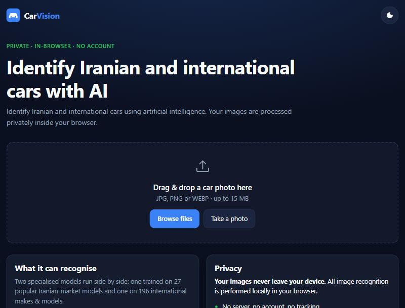
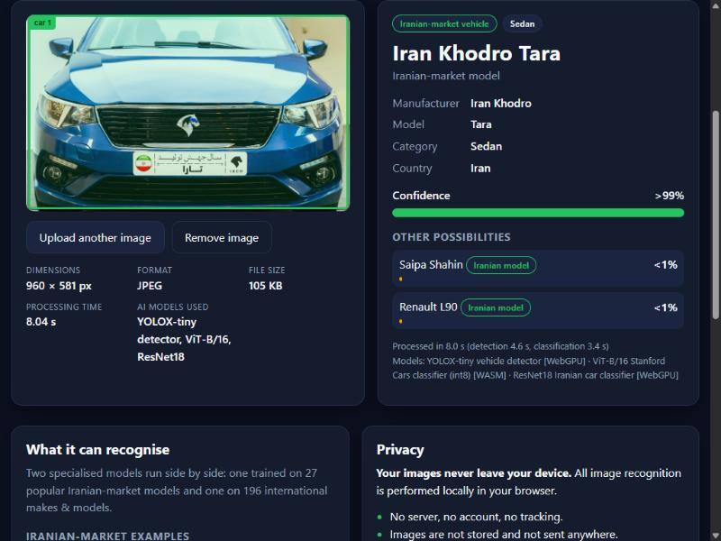

# CarVision – AI car recognition in your browser

Identify **Iranian-market** and **international** cars from a photo. Everything – car detection, model
recognition, routing between the two classifiers – runs **locally in the browser** with ONNX Runtime Web
(WebGPU when available, WebAssembly otherwise). There is no backend, no API, no account and no upload.

| Home | Result |
|---|---|
|  |  |

<sub>Result screenshot: photo "Tara" by Saeed Sajjadi, [CC BY 4.0](https://creativecommons.org/licenses/by/4.0/), via Wikimedia Commons.</sub>

> **Read this first – what the AI can and cannot do.** The recognition is real (three real pretrained models,
> nothing is faked or hard-coded), but it is a statistical estimate with clear limits. See
> [Known limitations](#known-limitations) and [docs/RESEARCH.md](docs/RESEARCH.md) for the measured numbers.

## Features

* Drag & drop, file picker, camera capture on phones; JPG / PNG / WEBP up to 15 MB; real validation (magic bytes,
  pixel-count guard, corrupted-file handling); EXIF orientation honoured; huge photos are down-scaled once.
* Vehicle **detection** first (so the classifier sees the car, not the street); several cars → click a box to
  identify another one.
* Manufacturer, model, category, country (when known), confidence, top alternatives, image info, processing time,
  models/back-end used. Low-confidence and "uncertain" results are flagged, never presented as certain.
* Real progress only: model download bytes, "starting model", "detecting…", "identifying…".
* Dark / light theme, responsive, keyboard accessible, `prefers-reduced-motion` respected.
* Models are downloaded lazily, cached (Cache API) and the app shell is cached by a service worker, so it works
  **offline after the first visit**.

## Technology stack

HTML5 · CSS3 · vanilla JavaScript (ES modules) · [ONNX Runtime Web](https://onnxruntime.ai/docs/tutorials/web/) 1.31
(WebGPU → WASM) · Canvas / OffscreenCanvas · Web Worker · Vite (build only) · GitHub Actions + GitHub Pages.
No framework, no Node/ASP.NET/Python at runtime, no external AI API. Text recognition uses tesseract.js (self-hosted WASM). Python is used **only offline** to convert
weights to ONNX (`scripts/`).

## Models (what is actually implemented)

| Role | Model | Source / licence | Size | Backend |
|---|---|---|---|---|
| Vehicle detector (car / bus / truck) | YOLOX-tiny, COCO | [Megvii YOLOX](https://github.com/Megvii-BaseDetection/YOLOX) 0.1.1rc0 – Apache-2.0 | 20.2 MB | WebGPU → WASM |
| Iranian-market classifier, **27 classes** | ResNet18 `car_name_model.pth` converted to ONNX | [RezaGooner/Multi-Task-Iranian-Vehicle-Monitoring-System](https://github.com/RezaGooner/Multi-Task-Iranian-Vehicle-Monitoring-System) – MIT | 44.8 MB | WebGPU → WASM |
| International classifier, **196 classes** (Stanford Cars) | ViT-B/16, exported to ONNX + dynamic int8 | [therealcyberlord/stanford-car-vit-patch16](https://huggingface.co/therealcyberlord/stanford-car-vit-patch16) – Apache-2.0 | 87.0 MB | WASM¹ |

¹ int8 dynamic quantization uses `MatMulInteger`, which the WebGPU provider does not implement, so this model is
pinned to WASM (measured: ≈1.2–1.5 s per image either way).

Iranian classes: Arisan, Atlas, Dena, L90, Mazda vanet, Megan, Neissan, Pars, 206, 206 SD, 207, 405, Peykan, Pride,
Pride vanet, Pride 111, Quik, Rana, Rio, Saina, Samand, Shahin, Soren, Tara, Tiba, Tiba 2, Zantia.
International classes: the 196 Stanford Cars classes (US-market cars, mostly 1991–2012).

**Measured** (own evaluation, `scripts/eval_international.py`): the shipped int8 ViT scores **88.0 % top-1 /
96.3 % top-5** on 400 random Stanford Cars test images (fp32: 87.75 % / 96.5 %). The Iranian model's accuracy was
**not** independently measured (no public held-out Iranian test set was available offline); upstream claims 97 %
on its own split, which I could not reproduce. Full research report: [docs/RESEARCH.md](docs/RESEARCH.md).

**Not available / not implemented:** a model that knows cars newer than ~2012, Kia / Renault / Peugeot as
*international* makes (they are not Stanford Cars classes; Iranian-built Peugeots/Renaults/Kia Rio are covered by the
Iranian model), model-year or trim recognition. The Stanford "year" in a label is shown only as a *reference class year*.

### Text on the car (OCR) and the local vehicle database

After the image result is shown, the app reads text on the selected vehicle with self-hosted
[tesseract.js](https://github.com/naptha/tesseract.js) (Apache-2.0; English + Persian `best_int` language data, ≈7 MB, downloaded on first use,
no CDN) and matches the words against `public/data/vehicles.json` (a plain JSON file you can edit without touching code – see
[public/data/README.md](public/data/README.md)). A vehicle is only "identified" from text when there is model evidence
(a full alias or brand + model); a brand alone or an engine label (1.5, 2.0…) never names a model. The text result is shown next
to the image models' answer (agrees / differs) and never changes it. It can be switched off with the checkbox under the result.

Measured behaviour (own checks, not a benchmark): clean Latin badge text rendered on an image (TOYOTA COROLLA 1.8, LAMARI NEO 1.5,
PEUGEOT 206, SAIPA SHAHIN, MERCEDES C200, DENA+) was read and matched to the right database vehicle in all cases. On the real
960 px photos in my test set the engine found almost no usable badge text (mostly noise, which is filtered by confidence), and
**Persian text was not recognised reliably** with the available language data. Treat OCR as a bonus clue for close-up photos.

### How the two classifiers are combined

They are closed-set softmax models whose confidences are **not comparable** (the Iranian ResNet18 is over-confident
on foreign cars – 39 % of Stanford cars pass a 0.65 threshold). So the app never picks "the highest raw confidence":

1. Detect the main vehicle and crop it.
2. Run the international ViT. Top-1 ≥ **0.80** → international result (the Iranian model isn't even loaded).
3. Otherwise run the Iranian model. Top-1 ≥ **0.80** → Iranian result.
4. Otherwise → **"uncertain"**: closest guesses from both models are listed, labelled by domain.

Thresholds live in [`src/config.js`](src/config.js); the derivation and the data are in
[docs/RESEARCH.md §4](docs/RESEARCH.md).

## Run locally

Requires Node.js 20+.

```bash
npm install
npm run dev        # http://localhost:5173
npm test           # unit tests (router, post-processing, validation)
npm run build      # -> dist/
npm run preview
```

Debug switches (query string): `?backend=wasm` forces the CPU/WebAssembly back-end, `?worker=off` runs inference on
the main thread (the automatic fallback for browsers without module workers / OffscreenCanvas).

## Model files and conversion

The three `.onnx` files are committed in `public/models/` (largest is 87 MB – under GitHub's 100 MB limit, but expect a
size warning above 50 MB; Git LFS is **not** needed and would break Pages serving). To rebuild them (Python is needed
only here):

```bash
# 1. Iranian ResNet18 (weights from the MIT-licensed upstream repo, loaded with weights_only=True)
python scripts/convert_iranian.py car_name_model.pth public/models/iranian-cars.onnx

# 2. International ViT: download the Hugging Face model folder, then
python scripts/convert_international.py ./stanford-car-vit-patch16 ./out
#    -> out/international-cars.onnx (int8, copy to public/models/)
python scripts/eval_international.py out/international-cars.onnx out/international-labels.raw.json <stanford_test_images_dir>

# 3. Detector: official release asset, renamed
#    https://github.com/Megvii-BaseDetection/YOLOX/releases/download/0.1.1rc0/yolox_tiny.onnx -> public/models/vehicle-detector.onnx

# 4. Regenerate the international label table from the model's own config
npm run labels
```

Python deps: `torch torchvision onnx onnxruntime transformers pillow numpy`.

To host the models elsewhere (CORS enabled), build with `VITE_MODEL_BASE_URL=https://your.host/path/`.
No secrets or API keys exist in the frontend.

## Deploy to GitHub Pages

1. Create a repository (e.g. `carvision`), push this project to `main`.
2. *Settings → Pages → Build and deployment → Source: **GitHub Actions***.
3. The workflow [`.github/workflows/deploy.yml`](.github/workflows/deploy.yml) runs tests, builds with
   `BASE_PATH=/<repository-name>/` and deploys `dist/`. The site appears at `https://<user>.github.io/<repo>/`.

Nothing assumes the site is at the domain root: `vite.config.js` reads `BASE_PATH`, and all model/label/worker/WASM
URLs are derived from the base path. For a local check of the sub-path build:

```bash
BASE_PATH=/carvision/ npm run build && npx vite preview --base /carvision/
```

(On Windows Git Bash prefix with `MSYS_NO_PATHCONV=1`, otherwise it rewrites `/carvision/` into a Windows path.)

## Browser compatibility

Needs ES modules, WebAssembly, Canvas 2D. WebGPU is optional. Chrome / Edge (WebGPU + WASM) – tested; Firefox and Safari should work via WASM (WebGPU where shipped) but are **untested**, Web Workers with OffscreenCanvas preferred, automatic main-thread fallback otherwise.
See [docs/TESTING.md](docs/TESTING.md) for what was **actually** tested (Chromium only so far).

## Performance

First use downloads the models (up to ≈152 MB for an Iranian car: detector + ViT + ResNet18; ≈107 MB for a foreign car
the ViT recognises confidently) plus a 29.5 MB WASM runtime; afterwards everything comes from cache. Typical latency
after warm-up on a desktop Chromium: **≈1.2–2 s per image** (WASM only: ≈1.7–2 s; the very first run adds ≈5–8 s of one-off initialisation / shader compilation). Memory: model sessions are released after 10 minutes idle and on page hide.

## Privacy

Images are decoded in your browser, passed to a Web Worker and never sent anywhere – the only network requests are
for the app's own static files (page, WASM runtime, models, label files). Nothing is stored permanently: the only
persisted data are the model files and app shell (browser caches) and the theme preference. Verified by inspecting the
network log and by running a full recognition with the web server stopped.

## Known limitations

* **Out-of-domain confidence is unstable.** For cars the ViT does not know (e.g. a real Samand), its top class and
  confidence can swing a lot with a few pixels of crop change (measured 0.39 → 0.79). About 10–14 % of the Iranian
  test photos were therefore named as an old foreign look-alike (e.g. "Audi 100 1994"). No fix was found that is
  worth its cost (test-time augmentation helps only a little, see research report).
* **Cars newer than ≈2012 are largely unknown** to the international model.
* Stricter thresholds mean many correct-but-moderate results (e.g. 54–79 %) are reported as "uncertain" with the best
  guess listed.
* Some Iranian dataset labels (Arisan, Atlas, Rana, Zantia, "Neissan") couldn't be mapped to a verified make; the
  dataset label is shown without invented details.
* The detector (YOLOX-tiny) sometimes misses a car (observed: a Renault L90 photo) and returns bystander cars.
* Iranian-model accuracy is unmeasured here; the Iranian training data's own licence isn't stated by its author
  (only trained weights are redistributed).
* Heavily blurred photos (10 px blur) are not detected as containing a car.

## Licence & attribution

Application code: MIT ([LICENSE](LICENSE)). Model weights keep their own licences, listed above (Apache-2.0, MIT,
Apache-2.0). ONNX Runtime Web: MIT. The Stanford Cars dataset
([Krause et al., 2013](https://ai.stanford.edu/~jkrause/cars/car_dataset.html)) is used for the international model's
labels and for evaluation only; no dataset images are redistributed.
